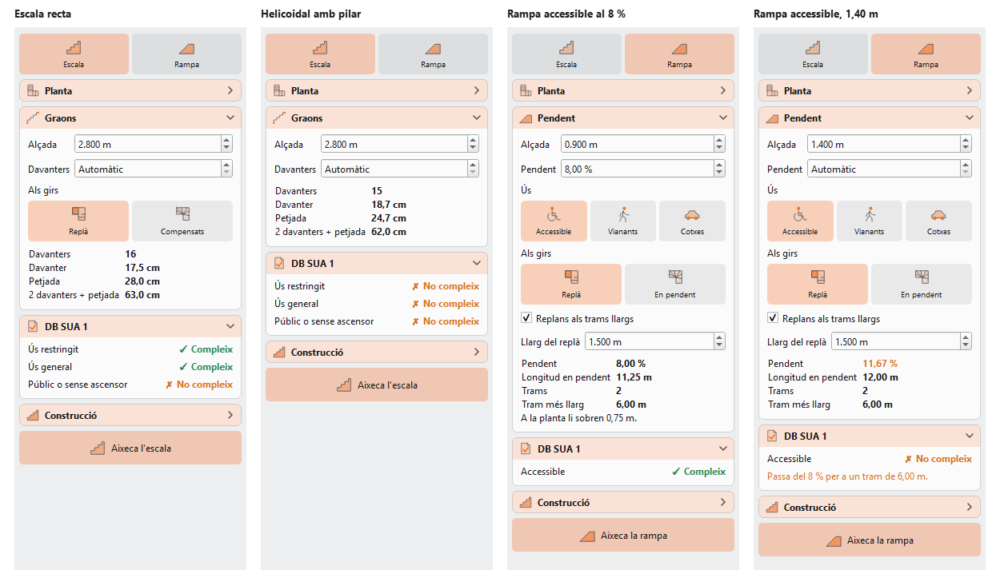

# Extensions CTE per a IngeTrazo

Sèrie d'extensions d'[IngeTrazo](https://github.com/ingelibre/ingetrazo) lligades al **CTE** (Código Técnico de la Edificación).

| Extensió | DB | Estat | Carpeta |
|---|---|---|---|
| **CTE Escales i rampes** | SUA 1 | 0.3.0, en proves | [escales-i-rampes](escales-i-rampes/) |

Cada extensió té la seva carpeta, amb el paquet que s'instal·la (`cte_…`), les proves i el seu README.

## Avís

Les comprovacions cobreixen només una part de cada Document Bàsic, la que indica cada README. **No substitueixen la lectura de la norma ni el criteri del tècnic competent.** El text oficial és a [codigotecnico.org](https://www.codigotecnico.org/).

## Llicència

GPL-3.0-or-later.
