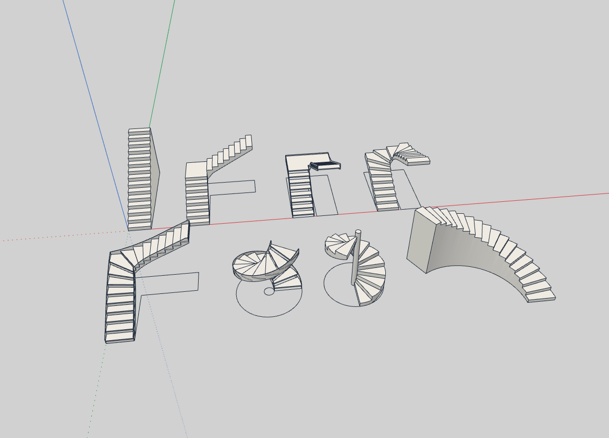
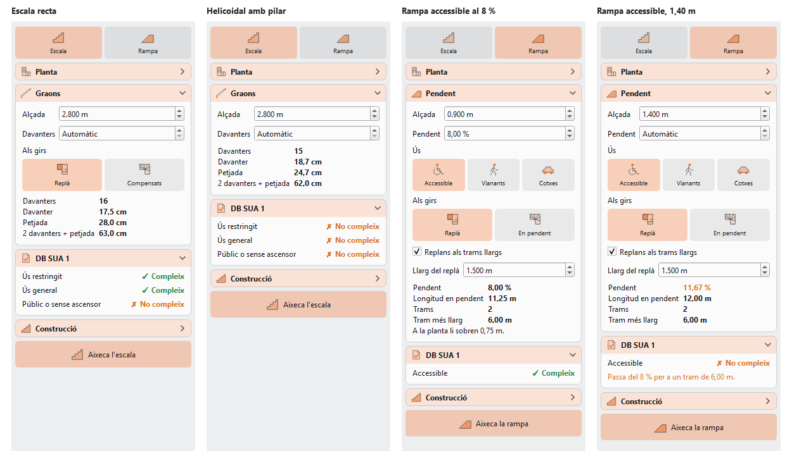
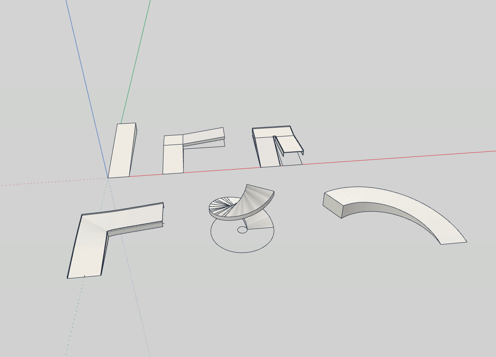

# CTE Escales i rampes (extensió d'IngeTrazo)

Aixeca una escala o una rampa a partir del dibuix en planta. És la primera d'una sèrie d'extensions lligades al CTE (Código Técnico de la Edificación). El paquet es diu `cte_stairs`. Versió 0.3.0, sense publicar.



## Instal·lació

Copia la carpeta `cte_stairs/` dins la carpeta de plugins d'IngeTrazo (**Extensions ▸ Obre la carpeta de plugins**) i reinicia el programa. Les proves es fan amb el codi d'IngeTrazo 0.6.3.2.

Per provar-la: [`docs/prova-escales.igz`](docs/prova-escales.igz) té plantes de cada tipus.

## Ús

1. Posa el dibuix de la planta dins un **grup**, selecciona'l i prem **Aixeca l'escala**. Sense selecció, clica el grup a la vista.
2. Damunt la planta es veuen els graons i la fletxa de pujada.
3. **Clica el punt d'arribada** o **escriu l'alçada**. Intro tot sol usa la del tauler.
4. Mentre no triïs una altra eina:

| Acció | Com |
|---|---|
| Canviar el nombre de davanters | escriu un enter (`16`) i Intro |
| Canviar l'alçada | escriu un decimal o una mida amb unitat (`2,90`, `3m`) |
| Triar per on arrenca (contorn) | clica prop de l'altre extrem, **Ctrl** o «Inverteix» |
| Triar el costat (línia oberta) | clica a un costat de la línia, o damunt per centrar-la |
| Tipus, replà o compensats, mides | al tauler; l'escala es refà |
| Acabar i passar a una altra planta | Intro, Esc, o clica una altra planta |

Tots els canvis queden en **un sol pas de desfer**. La planta no es modifica.

En l'estat d'ajust, un enter de 2 a 80 es llegeix com a nombre de davanters. Per posar una alçada rodona, escriu `3m` o `3,0`.

## Quines plantes entén

| Dibuix | Resultat |
|---|---|
| **Contorn tancat** (els dos laterals i els dos extrems) | recta, L, U, S, corbada o trapezoïdal |
| Contorn amb **línies de graó** de costat a costat | es respecten (compensades a mà incloses); la fletxa de pujada s'ignora |
| **Línia oberta** (trams i arcs) | l'amplada i el costat es posen al tauler |
| **Dos cercles** concèntrics | helicoidal amb ull; una línia radial marca l'arrencada |
| **Un cercle** | helicoidal amb pilar central |

En una escala en U cal deixar un **ull** entre els dos trams, encara que sigui d'1 cm.

## Com reparteix els graons

- Tria el nombre de davanters que deixa **2 davanters + 1 petjada** entre 60 i 65 cm omplint tota la planta; prefereix davanters de 14 a 18,5 cm. Si la planta no ho permet, ho avisa en taronja.
- «Davanters» al resultat és el nombre d'alçades. L'últim arriba al forjat de dalt, i per tant hi ha una petjada menys.
- La línia de petja va pel mig; si l'escala fa més d'1 m, a 50 cm del costat interior.
- **Replà:** tots els trams tenen la mateixa petjada; el que sobra queda al replà.
- **Compensats:** petjada constant a la línia de petja; al costat interior s'estreny a poc a poc, repartit amb els graons del voltant del gir.

## Veredicte DB SUA 1



En una targeta **DB SUA 1**, el tauler diu per a **cada ús** (restringit, general, i públic o sense ascensor) si l'escala **✓ Compleix** o **✗ No compleix**. Els motius surten passant el ratolí per damunt de cada línia. No canvia l'escala, i el repartiment automàtic **no cerca complir**: segueix la regla de 60–65.

Es comproven les mides del CTE DB SUA 1, 4.1 i 4.2 ([text publicat](https://www.codigotecnico.org/pdf/Documentos/SUA/DBSUA.pdf), consultat el 2026-11-27):

| Condició | Restringit | General | Públic / sense ascensor |
|---|---|---|---|
| Davanter | ≤ 20 | 13 a 18,5 | 13 a 17,5 |
| Petjada recta | ≥ 22 | ≥ 28, totes iguals | igual |
| 2C + H | — | 54 a 70 | 54 a 70 |
| Corba, on es mesura | ≥ 22 a l'eix (a 50 cm del costat estret si fa més d'1 m) | ≥ 28 a 50 cm de la vora interior; 2C + H a 50 cm de les dues vores | igual |
| Corba, costats | estret ≥ 5, ample ≤ 44 | ample ≤ 44 | ample ≤ 44 |
| Tram mixt | — | petjada a l'eix de la corba ≥ la recta | igual |
| Amplada | ≥ 0,80 m | ≥ 0,80 m útils (fora on la petjada corba fa menys de 17 cm) | igual |
| Trams | — | ≥ 3 graons; ≤ 3,20 m d'alçada | ≥ 3 graons; ≤ 2,25 m |
| Replà en línia | — | ≥ 1,00 m | ≥ 1,00 m |

**No es comprova:** l'amplada que demanen la taula 4.1 i el DB SI segons l'ús i l'ocupació (pot ser de més de 0,80 m: 1,00 m en habitatge), els passamans, les baranes, els davanters obligatoris, l'alçada lliure, les portes i passadissos als replans, les excepcions de l'apartat 2 ni els casos en què es prohibeixen els trams corbs.

## Construccions

- **Massissa:** tot massís fins al terra.
- **Llosa:** llosa de formigó de gruix regulable (15 cm). El replà és pla per sota.
- **Platines:** platines laterals (totes dues o una), petjades entre elles, amb davanter o sense.

Cada peça és un sòlid tancat. Les platines, petjades i davanters són peces separades amb nom dins el grup de l'escala.

## Rampes

Tria **Rampa** a dalt del tauler. Les plantes, la manera de treballar i les tres construccions són les mateixes; les línies de graó dibuixades s'ignoren.



- **Pendent automàtic:** la rampa omple la planta.
- **Pendent demanat:** després d'aixecar-la, escriu un enter (`8`) i Intro; amb decimals, al camp «Pendent». La rampa només arriba fins on cal i diu quant sobra. Si la planta és curta, l'omple i diu quants metres falten.
- Una alçada rodona s'escriu `1m` o `1,0`, perquè un enter de 2 a 40 és un pendent.
- **Als girs:** replà pla, o **en pendent** (el pendent continua i es reparteix com els graons compensats). Si el gir toca l'arrencada, no hi pot haver replà.
- **Replans als trams llargs:** un tram més llarg del que l'ús permet es parteix amb un replà (1,50 m, regulable).
- **Platines:** un tauler (3 cm) entre les platines laterals.

Igual que a les escales, el tauler diu **✓ Compleix** o **✗ No compleix**; a les rampes, els motius també surten escrits en taronja. Els límits són els del **CTE DB SUA 1, apartat 4.3** (contrastats amb el [text publicat a codigotecnico.org](https://www.codigotecnico.org/pdf/Documentos/SUA/DBSUA.pdf) el 2026-11-27), amb les longituds en planta. **No substitueixen la comprovació de la norma.**

| Ús | Pendent màxim | Tram màxim |
|---|---|---|
| Accessible | 10 % fins a 3 m; 8 % fins a 6 m; 6 % la resta | 9 m |
| Vianants | 12 % | 15 m |
| Cotxes (per on també passen persones, fora d'itinerari accessible) | 16 % | sense límit |

- **Criteri adoptat:** els 3 m i els 6 m justos s'accepten (3,00 m al 10 %, 6,00 m al 8 %). El text publicat del DB SUA diu «menor que».
- Amb pendent automàtic, posa els menys replans possibles que permetin complir. Amb pendent demanat, la llargada dels trams surt del pendent.
- En corbes, el límit s'aplica al **costat més desfavorable**.
- Fins al 4 % no es considera rampa i no s'hi apliquen límits.
- Itinerari accessible: avisa si fa menys d'1,20 m d'amplada, si un tram corba amb menys de 30 m de radi, o si els replans en línia fan menys d'1,50 m.

**No es comproven:** l'amplada de les rampes que no són accessibles (depèn del DB SI i de la taula 4.1), els 1,20 m horitzontals al principi i al final de cada tram accessible, les condicions dels replans amb canvi de direcció (amplada lliure, portes), la distància a portes i passadissos, el pendent transversal, els passamans, els sòcols laterals, el DB SUA 7 ni els acords de canvi de rasant de les rampes de cotxes.

## Límits d'aquesta versió

- Sense baranes.
- L'escala massissa i la llosa no descompten forjats ni murs; no es comprova l'alçada lliure.
- No dibuixa l'últim davanter en massissa i llosa (és el cantell del forjat de dalt).
- Platines: al racó interior d'un replà la platina fa un esglaó. Amb pilar central no hi ha platina interior.
- Helicoidal de més d'una volta: només té sentit en llosa o platines.
- No es pot reeditar una escala o rampa després de deixar l'eina. Els paràmetres i la planta ja es desen a `group.ext["cte_stairs"]`.
- Textos en català, castellà i anglès.

## Proves

```bash
INGETRAZO_SRC=<codi d'IngeTrazo> QT_QPA_PLATFORM=offscreen uv run --no-project --with pyside6 --with numpy --with pytest python -m pytest tests
```

El recorregut sencer de l'eina dins una finestra real (no es mostra a pantalla), que també fa les captures de `docs/shots`:

```bash
uv run --no-project --with pyside6 --with numpy python tools/shots.py <codi d'IngeTrazo> docs/shots
```

## Llicència

GPL-3.0-or-later.
